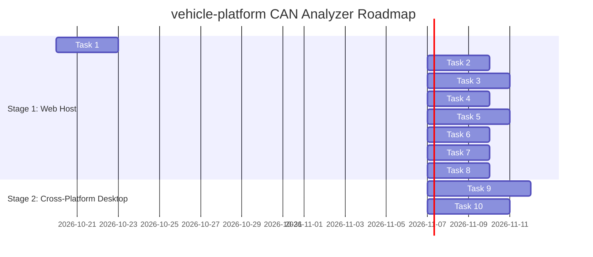

# vehicle-platform CAN Analyzer & Telemetry Cockpit — Master Plan & Market Benchmark

> **Superseded as a task list (Claude, 2026-10-24).** The analyzer became its own repo (D-081), not `vehicle-server/web`, and phases 0 and 3-6 are largely built. The live task list is `vehicle-analyzer/docs/ROADMAP.md`; the layer split (analyzer / vehicle-mcp / rider layer) is D-085. The market benchmark (§2) and the functional inventory (§3) stay valid as background.

**Status:** Idea / Architecture Proposal (Green Zone)  
**Date:** 2026-10-19  
**Target:** Web Host (Stage 1) → Cross-Platform Desktop (Mac / Linux / Windows via Tauri 2.0, Stage 2)  
**Reference Invariants:** D-009, D-020, D-021, D-033, D-037, D-076, D-077, D-078, D-079, D-080  

---

## 1. Executive Summary

This master plan establishes the complete architecture, functional inventory, and development roadmap for the **`vehicle-platform` CAN Analyzer & Telemetry Cockpit**.

The system addresses two operational stages:
1. **Stage 1 (Web Host):** Integrated directly into `vehicle-server` (FastAPI), providing zero-install, real-time CAN bus monitoring, signal plotting, UDS diagnostics, and session analysis in modern browsers via high-throughput WebSockets. Runs locally on the Raspberry Pi 5 (`linux-node`) in offline edge mode and on remote VPS-ready servers (D-077).
2. **Stage 2 (Native Desktop for Mac, Linux, Windows):** Packaged via **Tauri 2.0** sharing 100% of the Web Host frontend (React + TypeScript + uPlot), with a native Rust backend that directly interfaces with USB-CAN hardware (Linux SocketCAN, Windows/Mac PCAN-Basic, Candlelight/CANable SLCAN) with sub-millisecond latency, ~15 MB executable size, and minimal RAM footprint.

---

## 1.1 Current Platform Audit: What Is Implemented vs. What Is Missing

To answer the architectural question: *"Can all kinds of CAN analyses currently be performed on the platform?"* — we performed a strict gap analysis of the existing codebase (`vehicle-server`, `vehicle-defs`, `vehicle-connectivity-node`, `vehicle-rt-core`):

### What Is Currently Implemented (Existing Capabilities):
1. **Offline Post-Ride Validation (`vehicle-server/report.py`):**
   - Validates uploaded session archives (`.zip` containing CSVs or raw binary logs).
   - Verifies monotonic timestamps (`rx_mono_ms`, `device_time_ms`), detects packet loss/gaps (`GAP_MULTIPLIER = 3`), handles uint32 timer wraparound (~49.7 days), and flags unexpected MCU reboot/reset events.
   - Computes diagnostic tester stats: round-trip time (RTT min, max, average per DID), and step gap maximums.
   - Cross-checks raw hex payloads against decoded values to guarantee parser integrity.
2. **Derived Health Signals & Anomaly Reference (`vehicle-server/derived/` - D-070):**
   - Electrical health metrics: rest voltage, cranking voltage dip (`cranking_dip`), and internal resistance ($\Delta V / \Delta I$).
   - Thermal spread: ECT vs. IAT vs. ambient sensor deviations.
   - Ride summaries and context classification (`context.py`, `summary.py`).
3. **High-Speed Columnar & Standard Automotive Storage:**
   - `parquet.py`: Encodes time series into Apache Parquet (`signals.parquet`, `derived.parquet`) for fast analytical queries.
   - `mdf4.py`: Converts signals into ASAM MDF4 (`.mf4`), the automotive standard for tools like Vector CANape / MDA.
   - `index.py`: Stores ride metadata, distance, duration, and packet counts in a local SQLite index (`index.db`).
4. **Signal & Schema Decoding (`defs.py`, `decode.py`):**
   - Decodes BLE packets (telemetry v2/v3/v4, IMU, GPS) and applies `platform.dbc` formulas.

### What Is Missing / NOT Implemented (The Gap):
- ❌ **No Real-Time Streaming:** `vehicle-server` is currently purely batch-oriented via `POST /sessions`. There is NO WebSocket, SSE, or SocketCAN streaming endpoint to monitor the bus live.
- ❌ **No Visual User Interface (UI):** The platform currently has NO graphical cockpit or web dashboard. The API produces only JSON responses.
- ❌ **No Bus Monitor / Trace View:** No Overwrite mode (fixed ID table with live frequency, cycle time $\Delta t$, and change flashing) or Chronological scroll table.
- ❌ **No Byte Sniffer / Activity Heatmap:** No SavvyCAN-style color-coded byte diff (green = up, red = down, yellow = toggle) or Notch filter for reverse engineering undocumented ECUs.
- ❌ **No Interactive Oscilloscope / Waveform Viewer:** No graphical plotting of signals (RPM, Speed, TPS, Lean Angle) over time with dual cursors, zoom, or panning.
- ❌ **No Live UDS Diagnostic Console:** No UI to inspect DTCs, ISO 14229-1 status bitmasks, or D-080 Freeze Frames.
- ❌ **No Bus Load & Health Gauges:** No real-time Bus Load (%) meter, error frame counters, or live AUTOSAR E2E CRC8 / alive counter verification.
- ❌ **No 3D Telemetry or Map Visualization:** No Three.js 3D motorcycle lean orientation or GPS trajectory heatmap.
- ❌ **No Time Machine / Playback Scrubber:** No capability to replay a recorded session at variable speeds ($0.5\times - 5\times$) with synchronized frame stepping.
- ❌ **No Desktop Hardware HAL:** No native desktop application interfacing directly with USB-CAN adapters on Mac, Linux, or Windows.

**Conclusion:** `vehicle-server` today is an effective **headless, post-ride batch validation and ingestion engine**. None of the interactive, visual, or real-time CAN analysis features exist yet. The following phased development plan builds these capabilities systematically.

---

## 1.2 System Boundaries & Architectural Decoupling: CAN Analyzer vs. MCP vs. ML

A fundamental principle of the `vehicle-platform` SDV architecture is **strict decoupling of operational domains**:

```
┌────────────────────────────────────────────────────────────────────────────────────────┐
│                               vehicle-platform Ecosystem                                  │
├───────────────────────────────┬────────────────────────────┬───────────────────────────┤
│    CAN Analyzer Cockpit       │      LLM Assistant         │     Machine Learning      │
│   (Web Host & Desktop HAL)    │        (vehicle-mcp)          │        (vehicle-ml)          │
├───────────────────────────────┼────────────────────────────┼───────────────────────────┤
│ • Deterministic engineering   │ • Model Context Protocol   │ • Offline ML training &   │
│   cockpit (Zero AI dependency)│   RPC server for AI models │   feature extraction      │
│ • Real-time CAN bus trace     │ • Read-only tool execution │ • Anomaly detection &     │
│ • SavvyCAN byte sniffer/diff  │ • Windowed slice retrieval │   health baseline models  │
│ • 60 FPS signal oscilloscope  │ • Invariant 7: "LLM never  │ • Runs offline in batch   │
│ • ISO 14229 UDS diagnostics   │   does its own math"       │   mode (Python / PyTorch) │
│ • Bus load % & E2E supervisor │ • Separate service and repo│ • Separate service & repo │
│ • Direct hardware / WebSocket │   (`vehicle-mcp/`)            │   (`vehicle-ml/`)            │
└───────────────────────────────┴────────────────────────────┴───────────────────────────┘
```

1. **CAN Analyzer (Current Work):**
   - Pure, deterministic automotive engineering tool.
   - High-throughput message processing, hardware HAL (SocketCAN, PCAN, SLCAN), WebSockets, Canvas 2D/WebGL rendering.
   - Operates fully standalone; zero requirement for an LLM connection, internet access, or ML models to function.
2. **`vehicle-mcp` (Separate Service):**
   - Dedicated Model Context Protocol server exposing read-only JSON-RPC endpoints for LLMs (Claude, Gemini).
   - Consumes data via APIs; does not render UI or control bus hardware.
3. **`vehicle-ml` (Separate Service):**
   - Offline data-science and model training repository. Real ride data is never committed (D-033).
   - Generates trained weights; does not run the interactive analyzer UI.

---

## 2. Market Benchmark: Comprehensive Analysis of CAN Platforms

We examined 8 major commercial and open-source automotive analysis platforms to extract best-in-class workflows, UI patterns, and technical mechanisms:

| Platform | Category / Tech Stack | Core Strengths (What We Adopt) | Limitations (What We Solve) |
|---|---|---|---|
| **Vector CANalyzer / CANoe** | Automotive OEM Standard (C++ / Windows) | **Trace Overwrite Mode:** Fixed-row ID monitoring with cycle time ($\Delta t$), message frequency (Hz), and change highlighting. **Diagnostic Console:** ISO 14229 UDS DTC status masks and DID polling. **Bus Statistics:** Bus load % ($Load = \frac{\sum Bits \times t_{bit}}{T}$), peak load, error frame counters. | Prohibitive licensing cost, Windows-only desktop lock-in, closed-source, heavy resource footprint, no modern web streaming. |
| **SavvyCAN** (Collin Kidder) | Open Source Reverse Engineering (Qt / C++) | **Byte Sniffer (Heatmap):** Real-time color-coded byte activity (green for increment, red for decrement, yellow for fluctuating). **Notch Filter:** Mutes continuous background noise to isolate discrete button/switch triggers. **Flow View:** Timeline-based frame-by-frame bit inspection for a single selected ID. | Desktop-only Qt interface, lacks modern web socket streaming, struggles on multi-gigabyte Parquet/MDF4 archives, lacks native UDS ISO 14229 console. |
| **Comma.ai Cabana** | Web-Based Automotive RE (React / WebGL) | **Synchronized Route Scrubber:** Interactive time scrubber aligning video, CAN traffic, and decoded signals. **Bit-Level DBC Modeler:** Interactive bitfield matrix allowing drag-and-drop signal definitions over live payloads. | Deeply coupled to Comma Panda/Openpilot hardware, minimal UDS diagnostic capabilities, limited multi-channel support. |
| **Foxglove Studio** | Autonomous & Robotics Web/Desktop (TypeScript / WebGL) | **Dockable Panel Architecture:** Drag-and-drop customizable layout (Trace, Plot, 3D, Map, State). **60 FPS WebGL/Canvas Rendering:** Ultra-smooth multi-channel plotting. **WebSocket Binary Stream:** Low-latency live telemetry streaming. | General robotics focus rather than automotive CAN; lacks built-in UDS ISO 14229 diagnostic engines, DTC status decoders, or vehicle bus load analyzers. |
| **Intrepid Control Systems (Vehicle Spy 3)** | Industrial Engineering Suite (C++ / Windows) | **Activity & Message Monitor:** High-precision timestamp delta tracking. **Automated Function Blocks:** Event-driven script triggers. **Dual-channel comparison:** Synced multi-bus analysis. | Proprietary hardware dongle requirement, expensive commercial licenses, closed ecosystem. |
| **PEAK PCAN-View / Explorer 6** | Hardware Vendor Standard (Windows) | **Deterministic Receive/Transmit Tables:** Minimalist, rock-solid stability. **Macro Automation:** Simple repetitive command sequences. | Limited to PEAK hardware, basic graphical capabilities in standard edition, no web support. |
| **ETAS / Bosch BUSMASTER** | Open Source Automotive (C++ / MFC) | **DBC Symbol Association:** Clean mapping from raw bits to physical signals. **J1939 / UDS Monitors:** Standardized protocol filtering. | Outdated MFC user interface, Windows desktop only, abandoned community development. |
| **CSS Electronics (CANcloud + asammdf)** | Telematics & Fleet Cloud (Python / Web) | **MDF4 (ASAM) & Parquet Ingestion:** High-speed columnar query engine. **Signal Math & FFT:** Frequency spectrum analysis for vibration/anomaly detection. | Primarily file/batch oriented; lacks real-time interactive bus sniffing and live byte manipulation. |

---

## 3. Comprehensive Functional Inventory: What We Need for CAN Analysis

To build the definitive CAN analysis platform for `vehicle-platform`, the following 9 functional layers are required:

```
┌────────────────────────────────────────────────────────────────────────┐
│                        User Interface Cockpit                          │
│   Dockable Grid (Trace, Sniffer, Scope, UDS, 3D IMU, Map, Stats)       │
├────────────────────────────────────────────────────────────────────────┤
│                     Application Feature Layers                         │
│  [1. Bus Monitor]      [2. Byte Sniffer]      [3. Oscilloscope]        │
│  [4. UDS Diagnostics]  [5. Bus Health & E2E]  [6. 3D & GPS Telemetry]  │
│  [7. Time Machine]     [8. DBC/VSS Decoder]   [9. Scripting/Filters]   │
├────────────────────────────────────────────────────────────────────────┤
│                      Execution & Transport                             │
│   Web Host Mode (FastAPI + WebSocket)  │  Desktop Mode (Tauri 2.0 Rust)│
├────────────────────────────────────────────────────────────────────────┤
│                      Hardware Abstraction Layer                        │
│   SocketCAN (Linux) │ PCAN-Basic (Win/Mac) │ SLCAN (USB) │ vcan / HIL  │
└────────────────────────────────────────────────────────────────────────┘
```

### Layer 1: Hardware Abstraction Layer (HAL) & Source Adapters
- **Linux SocketCAN (`can0`, `can1`, `vcan0`):** Native Linux kernel network sockets on Raspberry Pi 5 (`vehicle-linux-node`) or development laptops.
- **USB-CAN Adapters (Candlelight / CANable / GS_USB):** Native USB CDC or winusb drivers.
- **PEAK PCAN-Basic DLL (`libpcanbasic`):** Support for PEAK-System USB adapters on Windows, Linux, and macOS.
- **Serial SLCAN / GVRET:** ASCII-over-serial protocol for Arduino/ESP32 adapters (`vehicle-connectivity-node`).
- **Network Telemetry Stream (D-077 WebSocket):** Zero-hardware browser connection to `vehicle-server`.
- **HIL Testbench & Virtual Bus (`vehicle-hil-bench`):** Scenario simulation and automated fault injection loops.

### Layer 2: Bus Monitoring & Trace Engine
- **Overwrite Mode (Matrix View):** One fixed row per CAN ID displaying:
  - CAN ID (Hex & Decimal), Extended/Standard flag (11-bit vs 29-bit).
  - Node Name / Transmitter (derived from DBC: `RT_CORE`, `SAFETY`, `CONN`, `ECU`).
  - Message Name (symbolic from DBC).
  - DLC (Data Length Code: 0–8 for Classic CAN, up to 64 for CAN FD).
  - Frame Count & Message Frequency ($Hz$).
  - Cycle Time ($\Delta t$ between consecutive frames of the same ID).
  - Raw Hex Payload Bytes with flash highlighting on update.
- **Scroll Mode (Chronological Log Stream):** Infinite virtualized table with:
  - Absolute Timestamp (microsecond resolution) & Relative Timestamp (since trace start).
  - Inter-frame Delta Time ($\Delta t_{bus}$).
  - Bus Channel (e.g. Channel 1: Vehicle CAN DLC, Channel 2: Platform CAN).
  - Direction (Rx / Tx).
- **Advanced Multi-Criteria Filtering Engine:**
  - Pass / Block filters by ID, ID ranges (e.g. `0x010-0x07F` Safety, `0x080-0x08F` Heartbeat).
  - Bitmask filtering (`ID & MASK == VALUE`).
  - Payload byte regex search.
  - Periodic rate anomaly filter (flagging messages arriving outside their expected `GenMsgCycleTime` $\pm 20\%$).

### Layer 3: Reverse Engineering & Sniffer Engine
- **Byte Activity Heatmap (SavvyCAN Pattern):**
  - Real-time 8-byte color matrix.
  - Green gradient: value increased.
  - Red gradient: value decreased.
  - Yellow: rapid fluctuation / toggling.
  - Dimmed / Gray: static, unchanging byte.
- **Notch Filter (Noise Elimination):**
  - Single-click "Notch" button: masks out constantly incrementing rolling counters, timers, and background noise so that manual rider inputs (brake switch, clutch, turn signal, throttle roll-on) stand out immediately.
- **Flow View (Single-ID Temporal Deep Dive):**
  - Visual 8×8 bit grid showing individual bit flips for a selected CAN ID over time.
  - Message-by-message playback and delta stepping.
- **Interactive Bitfield Scriptor (Cabana Pattern):**
  - Click-and-drag over raw bit matrices in the browser to draft new signal definitions (start bit, length, endianness, sign, scale, offset).

### Layer 4: Signal Decoding & Dictionary Engine
- **DBC Parser & Unpacker:**
  - Complete Motorola (Big-Endian) and Intel (Little-Endian) bit-unpacking.
  - Scaling factor, offset, physical minimum/maximum, and unit formatting.
  - Multiplexed signal decoding (supporting standard and extended multiplexing).
  - Direct integration with `vehicle-defs` (`platform.dbc`, `cl250.dbc`).
- **COVESA VSS Tree View:**
  - Hierarchical tree representation of decoded signals (`Vehicle.Motorcycle.*`, `Vehicle.Speed`, `Vehicle.Powertrain.CombustionEngine.Speed`).

### Layer 5: UDS Diagnostics & Vehicle Health (ISO 14229 / ISO 15765-2)
- **ISO-TP Transport Layer Monitor:**
  - Automatic reassembly of segmented multi-frame transfers (Single Frame, First Frame, Consecutive Frame, Flow Control).
- **Service 0x22 (ReadDataByIdentifier) Live Table:**
  - Live inspection table of polled engine DIDs (Engine Coolant ECT, Intake Air IAT, Throttle Position TPS, Manifold Pressure MAP, Battery Voltage, Lean Angle).
- **Service 0x19 (ReadDTCInformation) Fault Scanner:**
  - Active and confirmed DTC list.
  - ISO 14229-1 Status Byte breakdown: Bit 0 (`testFailed`), Bit 2 (`pendingDTC`), Bit 3 (`confirmedDTC`), Bit 4 (`testNotCompletedSinceLastClear`), etc.
- **D-080 Freeze Frame & Snapshot Decoder:**
  - Dedicated viewer displaying the vehicle operating state captured by the ECU at the exact moment a DTC was registered.
- **D-079 Health Snapshot Windows (W1–W5):**
  - Dedicated cards for:
    - **W1 (Key-On Engine-Off):** Rest voltage, fuel pump prime profile, sensor spread (ECT vs IAT vs Ambient).
    - **W2 (Cranking):** Cranking voltage dip, peak current, internal resistance ($\Delta V / \Delta I$), duration.
    - **W3 (Warm Idle):** Idle RPM stability, STFT spread, 0.5× / 1× engine order vibration RMS.
    - **W4 (Steady Cruise):** VE residual, final drive ratio, chassis vibration spectra.
    - **W5 (Post-Stop Cool-Down):** Coolant decay thermal time constant.

### Layer 6: High-Performance Oscilloscope & Mathematical Analysis
- **High-Throughput Time-Series Plotting (uPlot):**
  - Capable of rendering 100,000+ points at 60 FPS using HTML5 Canvas 2D without dropping frames.
  - Multi-axis synchronization: plot RPM (0–10,000), Speed (0–160 km/h), Lean Angle (-50° to +50°), and Battery Voltage (10–15 V) on a shared time axis.
- **Dual Measurement Cursors:**
  - Cursor A & Cursor B with automated differential calculation: $\Delta t$, $\Delta y$, slope ($\frac{\Delta y}{\Delta t}$), minimum, maximum, mean, and RMS in window.
- **Dynamic Decimation (LTTB Algorithm):**
  - Largest Triangle Three Buckets downsampling preserves visual peaks and valleys when viewing multi-hour ride sessions.
- **Vibration & Frequency Spectrum (FFT):**
  - Fast Fourier Transform panel for high-frequency engine accelerometer data (D-044) to analyze engine firing orders and bearing wear.
- **Virtual Channels / Mathematical Expressions:**
  - User-defined real-time calculated signals (e.g. `Wheel_Slip = Front_Speed - Rear_Speed`, `Electrical_Power = Voltage * Current`).

### Layer 7: Bus Performance & Safety Reliability
- **Real-Time Bus Load Meter:**
  - Continuous bus load percentage:
    $$\text{BusLoad} (\%) = \frac{\sum_{\text{window}} (\text{Bits}_{\text{frame}} + \text{StuffBits}) \times t_{\text{bit}}}{\text{WindowDuration}} \times 100$$
  - Current, 1-second average, and session peak load.
- **Error Frame & Controller State Tracker:**
  - Counters for Bit Errors, Stuff Errors, CRC Errors, Form Errors, ACK Delimiters.
  - CAN controller error states: Error Active, Error Passive, Bus-Off.
- **AUTOSAR E2E Profile 1/2 Supervisor:**
  - Real-time verification of `E2E_DataID`, 4-bit monotonic rolling counter, and SAE J1850 CRC8 calculation on protected platform CAN frames (0x020, 0x022, 0x081, 0x082).
  - Instant visual warning when alive sequence jumps or CRC mismatch occurs.

### Layer 8: 3D Telemetry, GPS & Spatial Dynamics
- **3D Motorcycle Attitude Indicator (Three.js):**
  - Real-time 3D motorcycle model responding to roll/lean angle and pitch from rt-core / safety-node EKF fusion.
  - Visual color bands for cornering warning levels (Green, Yellow, Red thresholds per D-041/D-065).
- **Private GPS Route & Heatmap Layer (D-076 Compliant):**
  - Local vector map rendering (MapLibre GL / Leaflet).
  - Trace route color-coded by vehicle speed, lean angle, or anomaly score.
  - Enforced zero third-party telemetry leaks: map data renders strictly from self-hosted or local tile caches.

### Layer 9: Time Machine, Replay & Session Comparison
- **Variable-Speed Replay Engine:**
  - Scrubbing, pause, single-frame step, looping, and variable speed ($0.1\times, 0.5\times, 1\times, 2\times, 5\times, 10\times$).
- **Dual Session Comparator:**
  - Synchronize Ride A and Ride B by distance or time to compare performance, engine degradation, or anomaly windows across different days.
- **Multi-Format Export & Ingestion:**
  - Supported formats: ASAM MDF4 (`.mf4`), Apache Parquet (`.parquet`), Vector ASC (`.asc`), CSV (`.csv`), PCAP (`.pcap`), and SQLite (`index.db`).

---

## 4. Cross-Platform Strategy: Web Host → Mac / Linux / Windows Desktop

To eliminate redundant development, we employ a **Unified Modern Tech Stack** where 100% of the UI and visualization components are shared between Web Host and Desktop builds:

```
                          ┌────────────────────────────────┐
                          │   Shared Frontend Codebase     │
                          │   React 18+ / TypeScript /     │
                          │   Vite / Tailwind / shadcn/ui  │
                          │   uPlot / TanStack Virtual     │
                          └───────────────┬────────────────┘
                                          │
                  ┌───────────────────────┴───────────────────────┐
                  ▼                                               ▼
     ┌────────────────────────┐                     ┌────────────────────────┐
     │  Stage 1: Web Host     │                     │  Stage 2: Desktop App  │
     │  (Browser Access)      │                     │  (Mac / Linux / Win)   │
     ├────────────────────────┤                     ├────────────────────────┤
     │  FastAPI + WebSocket   │                     │  Tauri 2.0 (Rust Core) │
     │  Served by vehicle-server │                     │  Native OS Webview     │
     │  Raspi 5 Edge & Cloud  │                     │  Direct Hardware HAL   │
     │  Zero client install   │                     │  SocketCAN, PCAN, SLCAN│
     └────────────────────────┘                     └────────────────────────┘
```

### Why Tauri 2.0 for Desktop?
1. **Tiny Binary Size:** ~15 MB executable (vs Electron's 150+ MB).
2. **Minimal Memory Footprint:** ~35 MB idle RAM (vs Electron's 300+ MB), crucial for running on low-spec field diagnostic laptops or alongside heavy HIL simulator processes.
3. **Rust Hardware Integration:** Rust's memory safety and zero-cost abstractions allow high-frequency CAN packet reading (10,000 frames/sec) on a dedicated native thread, pushing batches to the webview without event-loop bottlenecks.
4. **Platform-Native Drivers:**
   - **Linux:** Direct SocketCAN syscalls (`socket(PF_CAN, SOCK_RAW, CAN_RAW)`).
   - **Windows:** Native loading of `pcanbasic.dll` or serial SLCAN.
   - **macOS:** Native USB-serial / SLCAN driver with low-latency IOKit access.

---

## 5. Phased Task Decomposition & Implementation Roadmap

The development is divided into 10 focused, iterative tasks:



## 5. Granular Task Decomposition & Incremental Roadmap (Micro-Tasks)

To ensure a slow, disciplined, and strictly verifiable engineering process, the roadmap is broken down into **10 distinct phases** (Phase 0 through Phase 9). Each phase contains atomic micro-tasks with explicit contracts, target files, and automated acceptance criteria:

---

### Phase 0: Foundations & Data Contracts — [COMPLETED ✅ 2026-10-19]
*Objective: Establish shared schemas, TypeScript types, and virtual CAN data generators without modifying core firmware or breaking existing tests.*

- **Task 0.1 — Shared Data Transfer Objects (DTOs): [DONE]**
  - **Goal:** Define strict JSON/binary serialization contracts between backend and frontend.
  - **Implemented Models:**
    - `CanFrameDto`: `{ timestamp_us, channel, id, is_extended, dlc, data_hex, rxtx }` + `bytes_list()` helper
    - `DecodedSignalDto`: `{ name, value, unit, timestamp_us, raw_value, is_valid }`
    - `BusStatsDto`: `{ timestamp_us, channel, bus_load_pct, frame_rate_hz, peak_load_pct, error_frames, controller_state }`
    - `DtcRecordDto`: `{ code, description, status_byte, confirmed, pending, failed, snapshot_data }`
    - `StreamBatchDto`: Batch container grouping frames, decoded signals, and stats
    - `StreamMessageDto`: Top-level envelope for WebSocket protocol
  - **Delivered Files:** `vehicle-server/src/vehicle_server/schemas/stream.py`, `vehicle-server/src/vehicle_server/schemas/__init__.py`
  - **Verification:** Validated by unit tests; 100% Pydantic v2 compliant.

- **Task 0.2 — Virtual Replay Generator (Mock Streamer): [DONE]**
  - **Goal:** Provide a software-only CAN frame generator for development, streaming existing Parquet/CSV ride sessions or synthetic dynamics at realistic timestamps.
  - **Delivered Files:** `vehicle-server/src/vehicle_server/mock_stream.py` (CLI + async generator)
  - **Verification:** Unit tested in `vehicle-server/tests/test_mock_stream.py`. Emits realistic frames for 0x020 (EkfLean), 0x021 (VehicleSpeed), 0x110 (VehicleEngine), 0x081 (Heartbeat), and 0x18DAF110 (UDS) at 50 Hz.
  - **Test Suite Status:** 267/267 tests passing in `vehicle-server`, `ruff` clean, GREEN zone.

---

### Phase 1: `vehicle-server` Live Streaming & Columnar Query Engine — [IN PROGRESS 🟡]
*Objective: Extend `vehicle-server` from a batch-only processor to a dual-mode (batch + live stream) engine per D-077.*

- **Task 1.1 — FastAPI WebSocket Endpoint (`/ws/live`): [NEXT UP]**
  - **Goal:** Bi-directional WebSocket endpoint accepting client subscription parameters (e.g. `{"filter_ids": [0x020, 0x100], "rate_limit_hz": 50}`).
  - **Target Files:** `vehicle-server/src/vehicle_server/api.py`, `vehicle-server/src/vehicle_server/stream.py`
  - **Acceptance Criteria:** `pytest` test verifies WebSocket handshake, client subscription, and graceful disconnect under 1,000 frames/sec.

- **Task 1.2 — High-Throughput Broadcast Channel Manager:**
  - **Goal:** Memory-leak-free async publisher with fixed-size ring buffers per client to avoid slow-consumer backpressure.
  - **Target Files:** `vehicle-server/src/vehicle_server/stream.py`
  - **Acceptance Criteria:** 5 concurrent WebSocket connections receive 500 msgs/s without memory growth over 10 minutes.

- **Task 1.3 — Columnar Time-Series Query Endpoint (`/api/sessions/{id}/series`):**
  - **Goal:** Query Parquet data with server-side LTTB (Largest Triangle Three Buckets) downsampling to return ~1,000 visual points for arbitrary time ranges.
  - **Target Files:** `vehicle-server/src/vehicle_server/api.py`, `vehicle-server/src/vehicle_server/parquet.py`
  - **Acceptance Criteria:** Querying a 100,000-row session for 4 signals returns downsampled JSON in < 40 ms.

- **Task 1.4 — Schema & Symbol Catalog API (`/api/defs/catalog`):**
  - **Goal:** Serve message names, signal definitions, scale, offset, and unit metadata parsed from `vehicle-defs` (`platform.dbc`, `cl250.dbc`, `uds/vehicle_cl250.yaml`).
  - **Target Files:** `vehicle-server/src/vehicle_server/api.py`, `vehicle-server/src/vehicle_server/defs.py`
  - **Acceptance Criteria:** Endpoint returns verified signal definitions matching `vehicle-defs` tag without manual literals (Invariant 2).

---

### Phase 2: Frontend Cockpit Skeleton & Dockable Panel Layout
*Objective: Build the responsive Single Page Application (SPA) shell in `vehicle-server/web`.*

- **Task 2.1 — Project Initialization & Tailwind Setup:**
  - **Goal:** Initialize Vite + React 18 + TypeScript + Tailwind CSS with dark-mode automotive theme (slate/zinc palette).
  - **Target Files:** `vehicle-server/web/package.json`, `vehicle-server/web/vite.config.ts`, `vehicle-server/web/tailwind.config.js`
  - **Acceptance Criteria:** `pnpm dev` or `npm run dev` serves empty dashboard at `http://localhost:5173` with 0 console warnings.

- **Task 2.2 — Dockable Grid Layout Manager:**
  - **Goal:** Implement resizable, split-screen panel container allowing users to arrange Trace, Scope, and Diagnostic panels.
  - **Target Files:** `vehicle-server/web/src/components/layout/CockpitGrid.tsx`
  - **Acceptance Criteria:** User can drag panel splitters, collapse/expand panels, and layout state persists in `localStorage`.

- **Task 2.3 — Central WebSocket State Store (Zustand):**
  - **Goal:** High-frequency circular buffer (RingBuffer holding last 5,000 frames) with automatic reconnection.
  - **Target Files:** `vehicle-server/web/src/store/useCanStore.ts`
  - **Acceptance Criteria:** Sustains 1,000 frames/sec incoming payload without triggering excessive React re-renders (using selective subscriptions).

---

### Phase 3: Real-Time Bus Monitor & Trace Panel
*Objective: Recreate the core Vector CANalyzer monitoring experience.*

- **Task 3.1 — Overwrite Mode Matrix Table:**
  - **Goal:** Table with one fixed row per active CAN ID showing ID, Name, Node, DLC, Count, Freq (Hz), $\Delta t$ (ms), and Hex Bytes.
  - **Target Files:** `vehicle-server/web/src/components/trace/OverwriteTable.tsx`
  - **Acceptance Criteria:** Table dynamically adds rows for new IDs; existing rows update in place without re-sorting the DOM.

- **Task 3.2 — Byte Flash Highlighting Animation:**
  - **Goal:** Bytes that changed value flash green (increase) or red (decrease) for 300 ms, then return to baseline.
  - **Target Files:** `vehicle-server/web/src/components/trace/ByteCell.tsx`
  - **Acceptance Criteria:** Visual confirmation on changing values; static bytes remain un-highlighted.

- **Task 3.3 — Scroll Mode (Chronological Log) with Virtual Scrolling:**
  - **Goal:** Virtualized streaming log displaying every frame with microsecond timestamp.
  - **Target Files:** `vehicle-server/web/src/components/trace/ScrollTable.tsx`
  - **Acceptance Criteria:** Smooth 60 FPS scrolling through 50,000+ logged frames using `@tanstack/react-virtual`.

- **Task 3.4 — Multi-Criteria Search & Filter Toolbar:**
  - **Goal:** Filter by ID range (`0x010-0x07F`), node name (`RT_CORE`), payload byte pattern (`0x02 0x10 *`), or cycle time anomaly.
  - **Target Files:** `vehicle-server/web/src/components/trace/TraceFilter.tsx`
  - **Acceptance Criteria:** Filter applies instantly (< 5 ms) to incoming stream and historical trace.

---

### Phase 4: SavvyCAN-Style Reverse Engineering & Byte Sniffer
*Objective: Equip the cockpit with byte-level reverse engineering and noise-canceling tools.*

- **Task 4.1 — 8-Byte Heatmap Matrix:**
  - **Goal:** Color-coded 8-byte activity grid per ID (Green = incrementing, Red = decrementing, Yellow = toggling, Gray = inactive).
  - **Target Files:** `vehicle-server/web/src/components/sniffer/HeatmapGrid.tsx`
  - **Acceptance Criteria:** Counter bytes glow green; stable sensors fade to gray after 5 seconds of inactivity.

- **Task 4.2 — Noise Mute / Notch Filter:**
  - **Goal:** One-click "Notch" button that freezes current delta masks and hides continuous background chatter.
  - **Target Files:** `vehicle-server/web/src/components/sniffer/NotchFilter.tsx`
  - **Acceptance Criteria:** After clicking Notch, only newly triggered changes (e.g. brake lever switch) illuminate.

- **Task 4.3 — Flow View (Single-ID Bit Temporal Inspector):**
  - **Goal:** Step-by-step bit-transition inspector for an isolated CAN ID, displaying an 8×8 bit grid with $0 \rightarrow 1$ and $1 \rightarrow 0$ indicators.
  - **Target Files:** `vehicle-server/web/src/components/sniffer/FlowViewModal.tsx`
  - **Acceptance Criteria:** User can scrub through the history of a selected ID frame-by-frame and inspect individual bit flips.

---

### Phase 5: High-Speed Multi-Channel Oscilloscope & Math
*Objective: Industrial-grade graphical waveform visualization.*

- **Task 5.1 — uPlot Canvas 2D Integration:**
  - **Goal:** Embed `uPlot` within a responsive React wrapper for ultra-fast multi-channel plotting.
  - **Target Files:** `vehicle-server/web/src/components/scope/Oscilloscope.tsx`
  - **Acceptance Criteria:** Renders 100,000 points at 60 FPS with pan and zoom without browser UI stutter.

- **Task 5.2 — Multi-Axis Signal Picker & Scaler:**
  - **Goal:** Dynamic signal selector populated from `platform.dbc` (Speed, RPM, Throttle TPS, Lean Angle, Battery Voltage) with independent Y axes.
  - **Target Files:** `vehicle-server/web/src/components/scope/SignalPicker.tsx`
  - **Acceptance Criteria:** Toggling a signal checkbox adds/removes its curve and Y-axis scale instantaneously.

- **Task 5.3 — Dual Measurement Cursors (Cursor A & B):**
  - **Goal:** Two draggable vertical cursor lines displaying $\Delta t$, $\Delta y$, slope ($\Delta y / \Delta t$), and window min/max/mean statistics.
  - **Target Files:** `vehicle-server/web/src/components/scope/MeasurementCursors.tsx`
  - **Acceptance Criteria:** Delta readouts update smoothly in real time as cursors are dragged across the waveform.

---

### Phase 6: UDS Diagnostic Console & D-080 Freeze Frames
*Objective: ISO 14229 diagnostic inspection and fault analysis.*

- **Task 6.1 — DTC Fault Code & Status Mask Decoder:**
  - **Goal:** Display active, pending, and confirmed DTCs with ISO 14229-1 status byte breakdown (`testFailed`, `confirmedDTC`, `pendingDTC`).
  - **Target Files:** `vehicle-server/web/src/components/diag/DtcTable.tsx`
  - **Acceptance Criteria:** DTC codes are matched with standard descriptions and severe status bits are visually flagged.

- **Task 6.2 — D-080 Snapshot & Freeze Frame Cards:**
  - **Goal:** Render the engine operating snapshot captured at the exact moment a DTC occurred (RPM, ECT, speed, battery voltage).
  - **Target Files:** `vehicle-server/web/src/components/diag/FreezeFrameCard.tsx`
  - **Acceptance Criteria:** Successfully unpacks and displays D-080 freeze-frame payloads.

- **Task 6.3 — Live DID Inspection Grid (`0x22`):**
  - **Goal:** Live-updating card grid showing all engine DIDs polled by the vehicle tester.
  - **Target Files:** `vehicle-server/web/src/components/diag/DidMonitor.tsx`
  - **Acceptance Criteria:** Polled values update with correct units and threshold warning colors (e.g. ECT > 100 °C turns red).

---

### Phase 7: 3D Motorcycle Telemetry & D-079 Health Windows
*Objective: Spatial dynamics and ride-health analytics.*

- **Task 7.1 — Three.js 3D Motorcycle Attitude Indicator:**
  - **Goal:** Lightweight 3D motorcycle model reflecting real-time pitch and roll/lean angle from EKF data with green/yellow/red warning bands.
  - **Target Files:** `vehicle-server/web/src/components/telemetry/Motorcycle3D.tsx`
  - **Acceptance Criteria:** 3D model rotates smoothly at 60 FPS in WebGL matching lean angle changes.

- **Task 7.2 — D-079 Health Window Dashboard Cards:**
  - **Goal:** Cards for W1 (Key-On), W2 (Cranking Dip), W3 (Warm Idle), W4 (Cruise), and W5 (Cool-Down).
  - **Target Files:** `vehicle-server/web/src/components/telemetry/HealthWindows.tsx`
  - **Acceptance Criteria:** Displays qualification status, duration, and key residuals per window.

- **Task 7.3 — Private GPS Route & Heatmap Layer (D-076):**
  - **Goal:** Local vector map (MapLibre GL / Leaflet) rendering GPS trajectory color-coded by speed or lean angle without leaking coordinates externally.
  - **Target Files:** `vehicle-server/web/src/components/telemetry/GpsMap.tsx`
  - **Acceptance Criteria:** Map renders offline tiles; zero network requests sent to external third-party servers.

---

### Phase 8: Time Machine (Replay & Session Comparison)
*Objective: Interactive playback and multi-ride delta analysis.*

- **Task 8.1 — VCR Playback Scrubber:**
  - **Goal:** Timeline slider with play, pause, $0.25\times, 1\times, 2\times, 5\times$ speeds, and frame-by-frame stepping.
  - **Target Files:** `vehicle-server/web/src/components/replay/ReplayScrubber.tsx`
  - **Acceptance Criteria:** Moving the scrubber synchronizes Trace, Scope, and 3D Model to the selected millisecond.

- **Task 8.2 — Multi-Session Comparator (Ride A vs Ride B):**
  - **Goal:** Synchronize two ride sessions on a normalized distance or time axis to detect progressive component degradation.
  - **Target Files:** `vehicle-server/web/src/components/replay/SessionComparator.tsx`
  - **Acceptance Criteria:** Overlays Ride A and Ride B curves with automatic delta difference plotting.

---

### Phase 9: Native Cross-Platform Desktop Packaging (Tauri 2.0)
*Objective: Package the shared frontend into standalone native binaries for macOS, Linux, and Windows.*

- **Task 9.1 — Tauri 2.0 Project Setup & Webview Wrapper:**
  - **Goal:** Configure Tauri 2.0 wrapping the `vehicle-server/web` build.
  - **Target Files:** `src-tauri/Cargo.toml`, `src-tauri/tauri.conf.json`, `src-tauri/src/main.rs`
  - **Acceptance Criteria:** Native desktop window launches frontend cleanly on macOS, Linux, and Windows.

- **Task 9.2 — Rust Native Hardware Abstraction Layer (HAL):**
  - **Goal:** Implement direct SocketCAN socket reading on Linux, PCAN-Basic DLL loading on Windows, and Candlelight/SLCAN serial on macOS.
  - **Target Files:** `src-tauri/src/can_hal/`
  - **Acceptance Criteria:** Desktop app detects plugged USB-CAN adapter and streams frames directly to webview via Tauri events.

- **Task 9.3 — Production Packaging & CI Builds:**
  - **Goal:** Configure automated packaging scripts generating `.dmg` (macOS), `.deb` / AppImage (Linux), and `.msi` (Windows).
  - **Acceptance Criteria:** Standalone installer installs cleanly and runs without external runtime dependencies.

---

## 6. Platform Invariants & Safety Compliance

Every component of this master plan strictly adheres to the non-negotiable platform rules:

1. **Invariant 1 (ECU is Read-Only):**
   - In vehicle connection mode, transmit capabilities are strictly disabled in the UI and backend. The analyzer is a 100% passive listener/monitor on the vehicle bus.
   - Frame injection / stimulus is unlocked ONLY when connected to `vehicle-hil-bench` (HIL simulation) or a virtual CAN interface (`vcan0`).
2. **Invariant 2 (Never Invent Signals):**
   - All signal names, scaling factors, offsets, units, and DIDs are strictly derived from `vehicle-defs` definitions (`platform.dbc`, `cl250.dbc`, `uds/vehicle_cl250.yaml`, `derived/`).
   - No hardcoded signal literals exist in the analyzer codebase.
3. **Invariant 7 & D-076 (Position Privacy):**
   - GPS coordinates and trajectory data are displayed only within the user's authenticated application.
   - Map tiles are rendered using local/embedded vector tiles; coordinates are never sent to external third-party cloud services.
4. **Invariant 8 (Safety Path Isolation):**
   - The analyzer operates as a QM tool on the observation path. Safety decisions (cornering warning, blind spot, immobilizer) run deterministically on the Cortex-M4 safety partition and never depend on the analyzer.

---

## 7. Next Steps: Building the Prototype

With this master plan established:
1. Proceed with **Task 1** (`vehicle-server` WebSocket streaming endpoint) and **Task 2** (Vite + React frontend skeleton).
2. Validate live frame streaming using virtual CAN (`vcan0`) and recorded Parquet ride sessions.
3. Incrementally activate Trace, Sniffer, and Oscilloscope panels.
